# LF-DBViewer

A light MySQL/MariaDB client for macOS, built with Tauri 2: Rust does the database work,
the interface is plain HTML, CSS and JavaScript.

## Develop

Requirements: Rust (the pinned toolchain in `rust-toolchain.toml` installs itself through
rustup) and Node.js.

```bash
make install   # once
make dev       # run the app with live reload
make test      # JavaScript and Rust unit tests
make test-live # also the tests that need a MySQL/MariaDB server on 127.0.0.1
make lint      # rustfmt and clippy
make build     # release build of LF-DBViewer.app
```

## Preview

Screenshots use sample data (a small shop database); the app itself is a native window.

| | |
|---|---|
| 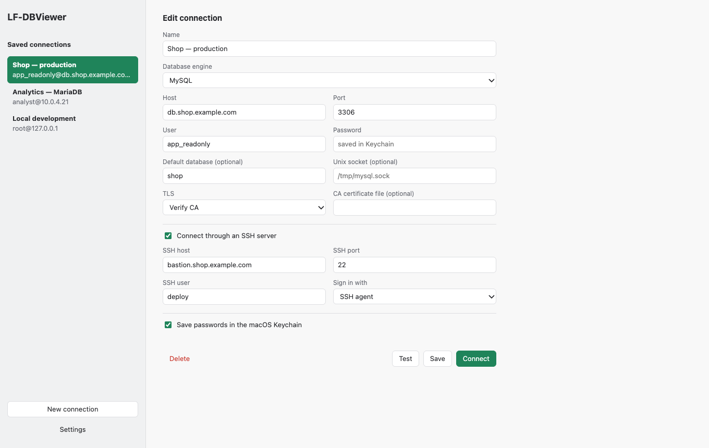 **Connections.** Saved logins, SSH tunnel, TLS, passwords in the Keychain. | 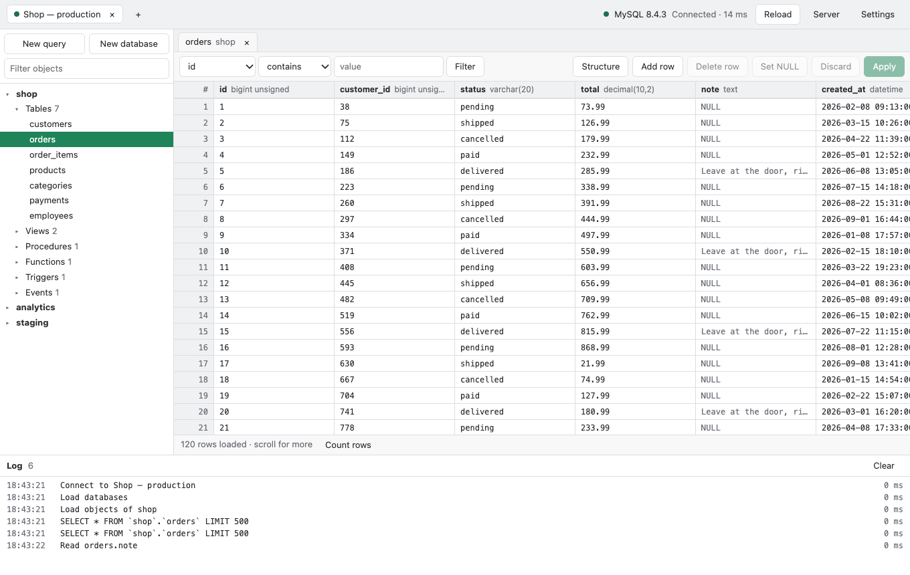 **Data grid.** Streams big tables, sorts and filters, exact row count on demand. |
| 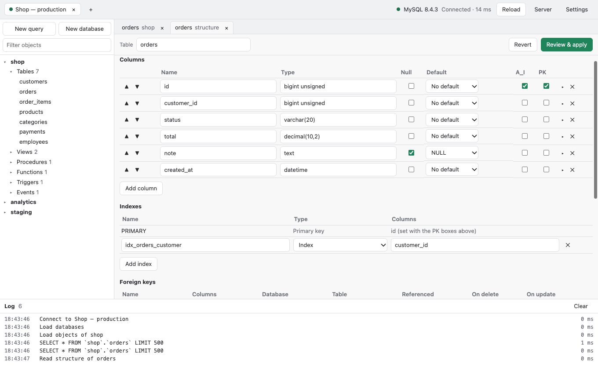 **Table designer.** Columns, indexes, foreign keys and checks; the SQL is shown before it runs. | 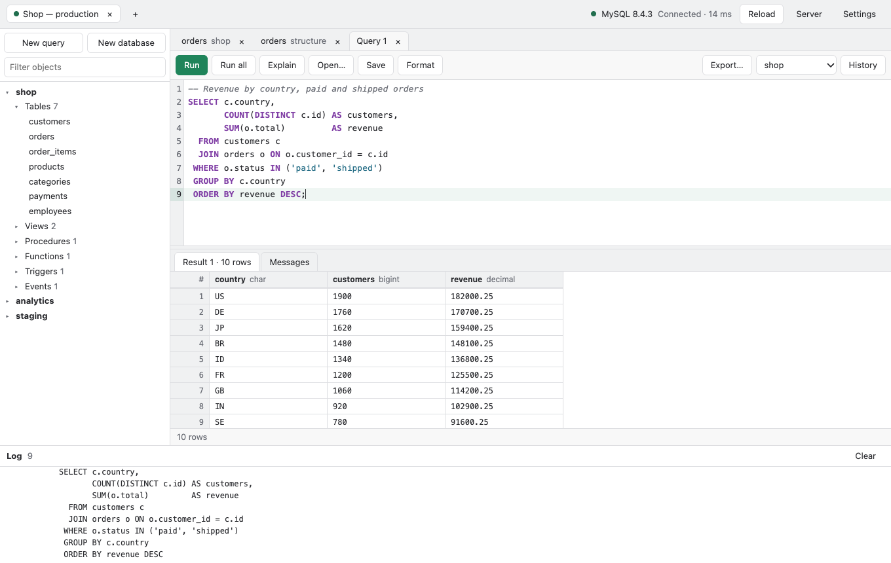 **Query editor.** Highlighting, formatting, several results, open and save `.sql` files. |
| 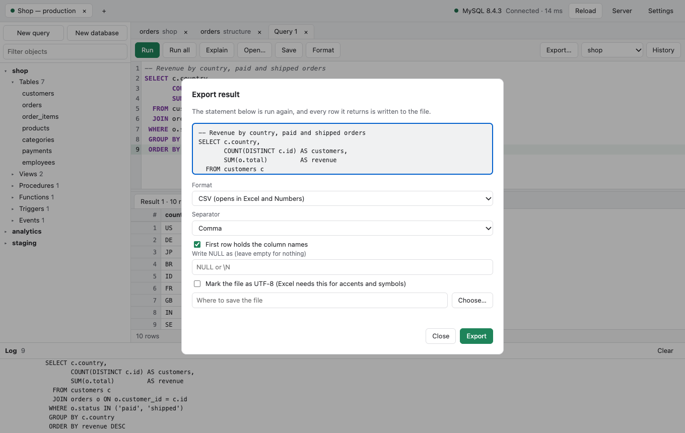 **Export a result** to CSV or JSON, every row, no truncation. | 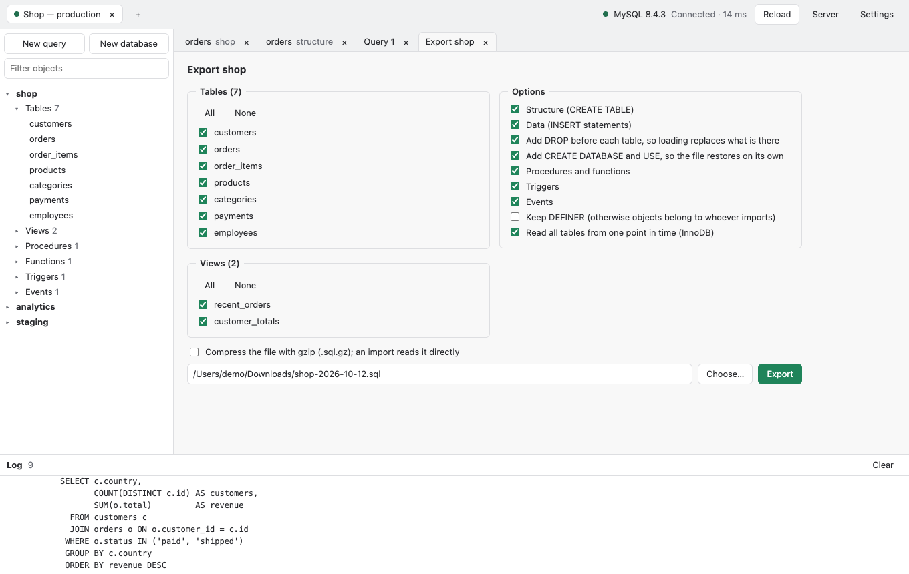 **Export a database** to a `.sql` or `.sql.gz` file that loads back identically. |
| 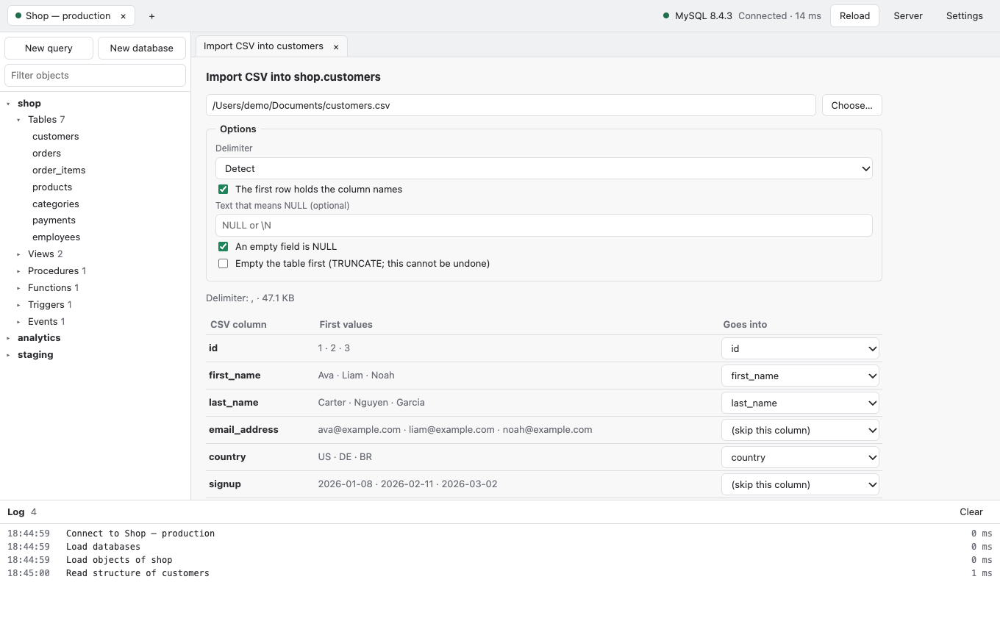 **Import CSV** with delimiter detection and column mapping, in one transaction. | 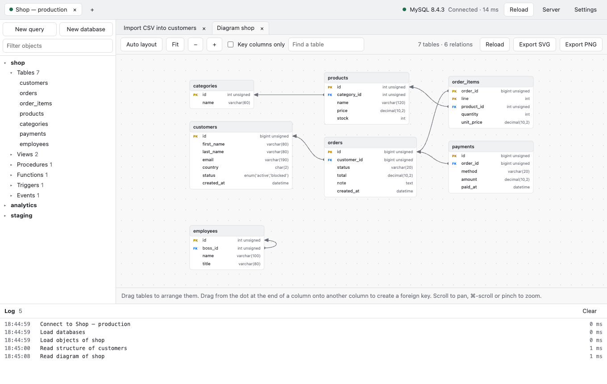 **Relationship diagram.** Drag tables, draw foreign keys (also composite), export SVG or PNG. |
| 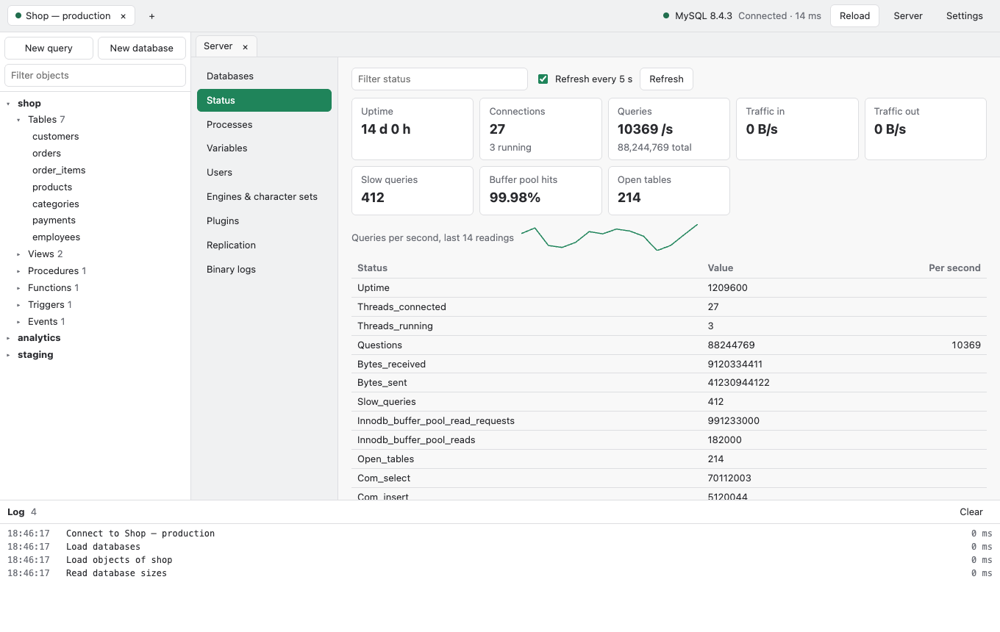 **Server status** with live rates and a query trend. | 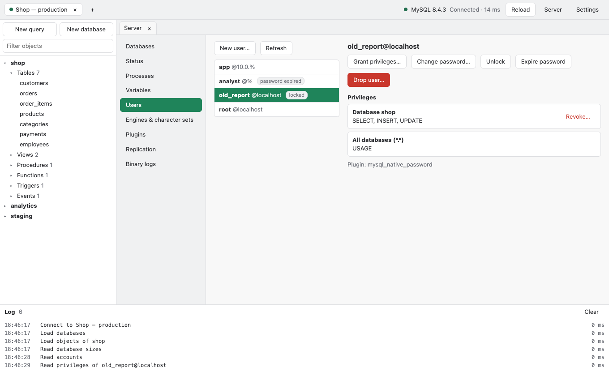 **Users and privileges**, with lock, unlock and password expiry. |
| 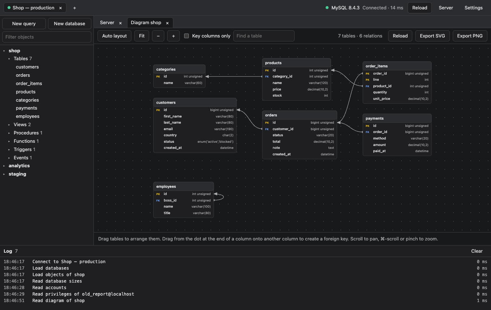 **Dark mode** next to the light theme. | 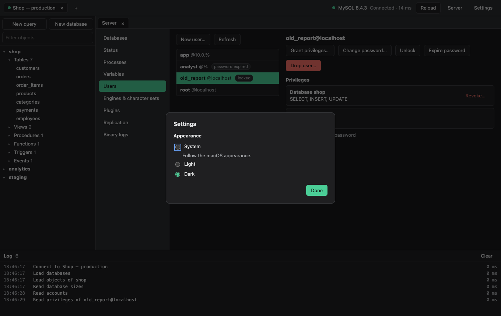 **Settings.** Follow macOS, or choose light or dark. |

## What it does

- Connect to MySQL and MariaDB, directly or through an SSH tunnel (password, key file or agent); passwords are kept in the macOS Keychain.
- Browse and edit table data (big tables stream in as you scroll), resize columns, open long text and binary values in full, run SQL with a multi-result editor.
- Design tables, indexes, foreign keys, checks and invisible columns, duplicate tables, edit views, routines, triggers and events, with the SQL shown before it runs.
- Export a database to a SQL file (optionally gzip) that loads back identically, import SQL files of any size, import CSV, export query results to CSV or JSON.
- See what the server is doing (status, processes, replication, plugins, binary logs, table sizes), change variables, manage users, privileges and account locks, and run table maintenance.
- A relationship diagram of any database: drag tables, draw foreign keys, export SVG or PNG.
- Light and dark themes (Settings, or ⌘,).

## Layout

- `src/`: interface, grouped by feature (`features/`), with pure state in `state/` and helpers in `lib/`.
- `src-tauri/src/connection/`: connection pool, SSH tunnel, MySQL client option files.
- `src-tauri/src/storage/`: saved connections (JSON) and passwords (macOS Keychain).
- `src-tauri/src/commands/`: the thin layer the interface calls.
